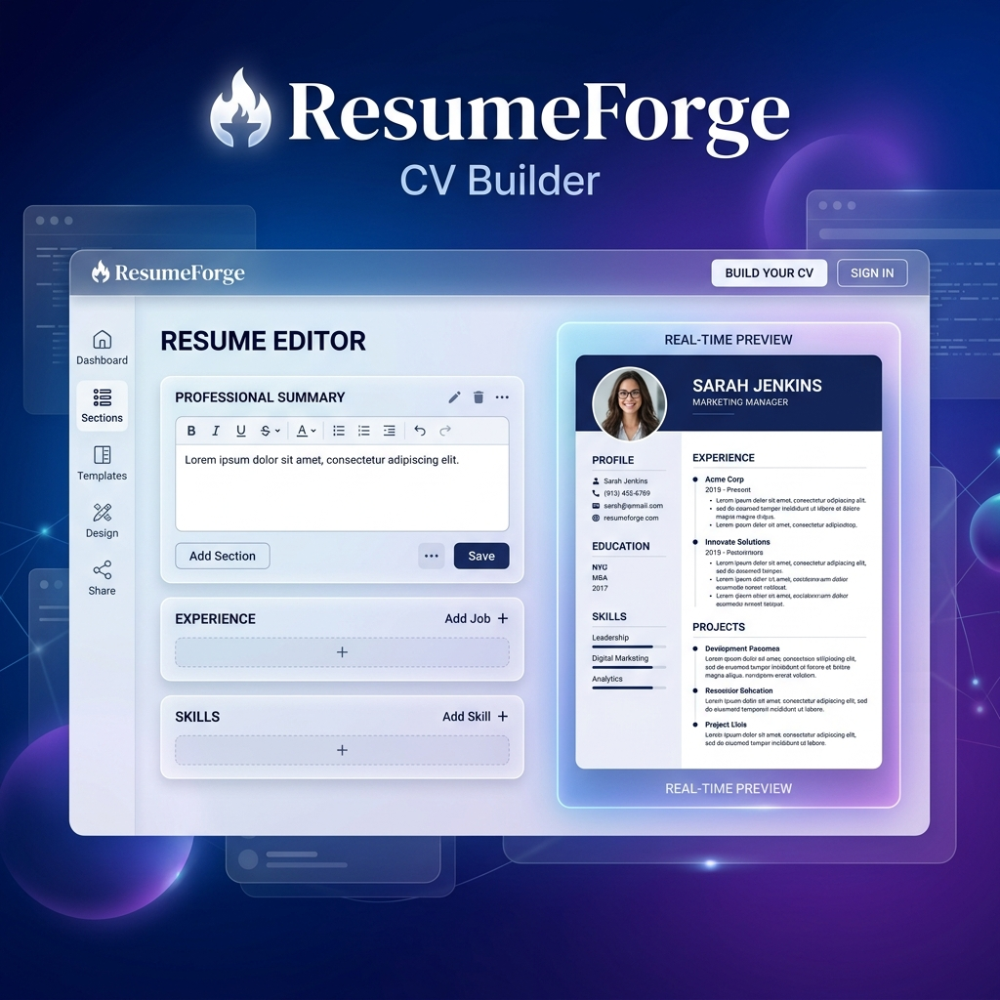

# 🚀 ResumeForge — Premium CV Builder

ResumeForge is a high-performance, client-side CV builder designed to empower professionals to create recruiter-ready resumes in minutes. Built with a focus on real-time feedback, high-fidelity typography, and seamless PDF export, it provides a "What You See Is What You Get" (WYSIWYG) experience that bridges the gap between design and data.



## ✨ Key Features

- **⚡ Live Visual Editor**: A side-by-side editing experience with instant real-time updates. No more "Preview" buttons—see your changes as you type.
- **📝 Rich Text Support**: Full formatting support for summaries and experience descriptions using the **Tiptap** engine. Bold, italicize, and structure your content with ease.
- **🎨 Dynamic Themes**: Choose from curated professional templates (Classic, Modern, Minimal, Bold, etc.) and customize them with a wide range of color palettes.
- **✒️ Precision Typography**: Optimized line heights, font pairings, and spacing for maximum readability and ATS compatibility.
- **📄 High-Fidelity PDF Export**: Pixel-perfect PDF generation using a headless browser pipeline (**Puppeteer**), ensuring your CV looks exactly the same on paper as it does on screen.
- **📱 Responsive Design**: A mobile-optimized editor interface that allows you to refine your resume on any device.
- **🔒 Privacy First**: Works entirely on the client-side. Your data never leaves your browser unless you choose to export it.

## 🛠️ Technology Stack

| Layer | Technology |
| :--- | :--- |
| **Framework** | [Next.js 15+](https://nextjs.org/) (App Router) |
| **Language** | [TypeScript](https://www.typescriptlang.org/) |
| **UI Library** | [React 19](https://react.dev/) |
| **Styling** | [Tailwind CSS v4](https://tailwindcss.com/) |
| **State Management** | [Zustand](https://github.com/pmndrs/zustand) with [Immer](https://immerjs.github.io/immer/) |
| **Rich Text** | [Tiptap](https://tiptap.dev/) |
| **PDF Engine** | [Puppeteer](https://pptr.dev/) (Serverless Friendly) |
| **Drag & Drop** | [dnd-kit](https://dndkit.com/) |
| **Icons** | [Lucide React](https://lucide.dev/) |

## 📐 Architecture Overview

ResumeForge follows a modular architecture to ensure high performance and maintainability:

1.  **State Management**: Uses a centralized Zustand store with Immer for atomic updates. This ensures that even complex nested structures (like multiple work experience entries) are handled predictably.
2.  **Rendering Engine**: The `TemplateRenderer` component is the heart of the app. It converts the JSON state into a highly structured A4-compliant HTML layout.
3.  **PDF Pipeline**: When exporting, the app sends the rendered HTML to a Next.js API route. This route launches a headless Chromium instance (via Puppeteer) to capture a pixel-perfect print of the DOM.
4.  **Design Tokens**: Themes, colors, and typography are managed via a robust design system implemented with Tailwind CSS and CSS Variables.

## 🏁 Getting Started

### Prerequisites

- **Node.js** 20.x or higher
- **npm**, **pnpm**, or **yarn**

### Installation

1.  **Clone the repository:**
    ```bash
    git clone https://github.com/rupomgg/ResumeForge.git
    cd cv-builder
    ```

2.  **Install dependencies:**
    ```bash
    npm install
    ```

3.  **Run the development server:**
    ```bash
    npm run dev
    ```

4.  **Launch the App:**
    Open [http://localhost:3000](http://localhost:3000) in your browser.

## 📁 Project Structure

```text
├── app/                  # Next.js App Router (Pages & API)
│   ├── api/pdf/          # Puppeteer-based PDF generation logic
│   └── editor/           # Main CV builder workspace
├── components/           # UI Components
│   ├── features/         # Feature-specific logic (Editor, Preview, Landing)
│   │   ├── editor/       # Core panels (Content, Design, Templates)
│   │   └── preview/      # Resume layout components
│   └── ui/               # Reusable Atomic UI primitives
├── store/                # Zustand State definitions
│   └── initial-state.ts  # Default resume data structure
├── lib/                  # Utilities, Themes, and Fonts
│   ├── fonts.ts          # Google Fonts integration
│   └── themes.ts         # Global design system tokens
├── public/               # Static assets
└── assets/               # Repository documentation assets
```

## 🗺️ Roadmap

- [x] **Core Engine**: Real-time CRUD operations for resume sections.
- [x] **A4 Preview**: High-fidelity rendering engine.
- [x] **PDF Export**: Puppeteer integration for high-quality downloads.
- [x] **Rich Text**: Tiptap integration for summaries.
- [ ] **Templates**: Add 10+ more industry-specific templates.
- [ ] **AI Assistant**: Integrate LLMs for resume optimization and bullet-point generation.
- [ ] **Persistence**: Cloud sync and LocalStorage auto-save.
- [ ] **Import**: Support for importing existing LinkedIn profiles or PDFs.

## 🤝 Contributing

Contributions are welcome! Please feel free to submit a Pull Request.

1. Fork the Project
2. Create your Feature Branch (`git checkout -b feature/AmazingFeature`)
3. Commit your Changes (`git commit -m 'Add some AmazingFeature'`)
4. Push to the Branch (`git push origin feature/AmazingFeature`)
5. Open a Pull Request

## ⚖️ License

Distributed under the MIT License. See `LICENSE` for more information.

---

Built with ❤️ by [Md Radwan Ahamed](https://github.com/rupomgg)
